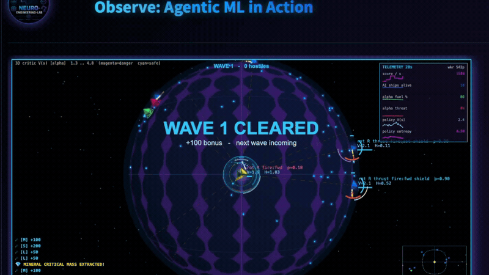
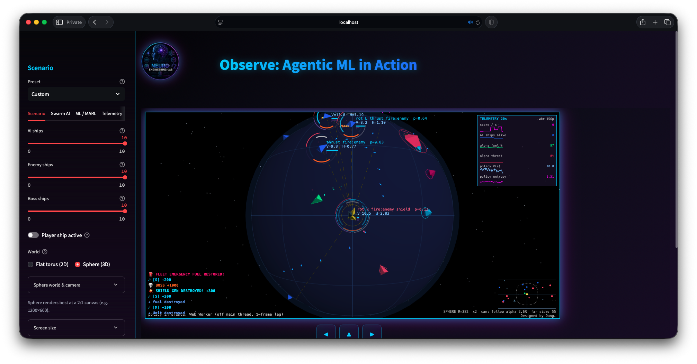
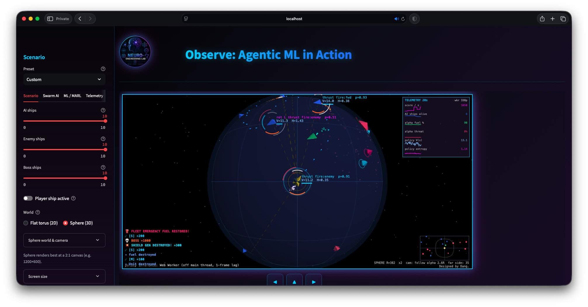

# Asteroids AI: Multi-Agent Deep Reinforcement Learning & Simulator

[](assets/Agentic-ML-2.mp4)
*▶ Autoplaying simulation preview above (click to open the full 60 FPS MP4 video).*





---

## Overview

**Asteroids AI** is a deterministic multi-agent reinforcement learning (MARL) combat simulator and 3D/2D arcade environment built with **zero-dependency JavaScript**, **Three.js**, and **Streamlit**.

- **Exact Spherical & Toroidal Physics (`world.js`, `sphere_view.js`)**: Play and train on a classic 2D flat torus or an interactive 3D spherical globe (`2×` default scale) with mouse drag-to-orbit, scroll-wheel zoom, click-to-inspect ship HUD cards, great-circle motion, and geodesic observations (`WORLD.delta()` / `WORLD.distance()`).
- **Train/Serve Parity (`sim/env.js`, `training/nn.js`, `policy_runner.js`, `policy_worker.js`)**: Headless PPO/MAPPO training (flat 48-action or factored 11-logit multi-discrete, optional `EntityAttentionNet` 103-dim encoder, centralized critic, and VDN/COMA credit) executes the *exact* `game.js` loop and `MLFeatureExtractor.extractRL()` pipeline, while browser inference runs the *exact* `training/nn.js` forward pass in a Web Worker.
- **Tactical Swarm & Combat Mechanics (`ai_ship.js`, `enemy_ship.js`, `enemy_coordination.js`)**: Alpha leader formations, autonomous mid-combat fuel tanker rescues with obstacle avoidance, escalating waves, 3-phase boss encounters (escorts + enrage), Mission Control orbital interventions, live HUD sparklines, action-probability wheels, 2D/3D critic value heatmaps, and 3D attention sightlines.

---

## Quickstart

### 1. One-Command Clean, Verify & Launch (Recommended)
```bash
./start.sh              # Cleans caches, runs test suite, launches Streamlit on http://localhost:8501
./start.sh --skip-tests # Fast restart on http://localhost:8501
./start.sh --web        # Launches standalone 3D web app on http://localhost:8000
```

### 2. Standalone 3D Web App (Direct HTML/JS)
```bash
python3 -m http.server 8000
```
- **Main Simulator**: `http://localhost:8000` (URL params: `?world=sphere|torus`, `?scale=1..3`, `?cam=alpha|fleet|boss|orbit`, `?zoom=1.4..4.5`, `?seed=<str>`, `?policy=none|<path>`, `?waves=0|1`, `?det=1`, `?heatmap=0`, `?overlay=0`, `?hud=0`)
- **Split-Screen A/B Policy Arena**: `http://localhost:8000/arena.html`
- **Flight Log Replay Scrubber**: `http://localhost:8000/replay.html`

### 3. Streamlit Control Dashboard
```bash
python3 -m venv .venv && .venv/bin/pip install -r requirements.txt
.venv/bin/streamlit run app.py
```
Open `http://localhost:8501`.

### 4. Docker (with Optional HTTPS via Caddy)
```bash
docker build -t asteroids-ai .
docker run -p 8501:8501 asteroids-ai
# Or with docker compose (includes optional Caddy reverse-proxy profile):
docker compose up --build
```

---

## Reinforcement Learning, Training & Benchmarks

All training and evaluation runs headlessly on macOS `JavaScriptCore` (`jsc`) or **Node.js**—no native ML dependencies required.

| Command | Purpose |
| --- | --- |
| `./run_tests.sh` | Run NN gradient checks, deterministic env tests, policy runner, waves, and JS syntax checks |
| `python3 tests/test_app_template.py` | Validate Streamlit HTML/JS template generation & XSS escaping |
| `python3 tests/run_browser_smoke.py` | Drive the real 3D game in headless Chrome |
| `python3 training/run_benchmark.py --suite quick --check` | Run CI regression gate against stored baseline |
| `python3 training/run_curriculum.py --tag r2 --seeds 4` | Multi-seed curriculum training on the 3D sphere |
| `python3 training/run_training.py --stage 3 --world sphere --worldScale 2 --fuelRescue 1 --waves 1 --bossPhases 1` | Train a 43-dim full-feature policy |
| `python3 training/run_self_play.py --rounds 4` | Train adversarial Red Swarm policies against a Blue league |
| `python3 training/update_registry.py` | Refresh `models/registry.json` metadata catalog |

### Benchmark Highlights
- **Curriculum `r1` (`swarm_sphere`, 40 Held-Out Seeds)**: 6 agents vs. 4 enemies + 2 bosses on the 2× globe — the trained PPO curriculum policy (`models/policy_swarm_sphere_x2.json`) achieves **2.5× random** and **5.7× rule-based heuristic** return (paired $t = 5.0\text{–}16.0$), doubling boss kills per 1k steps while keeping 4.6/6 ships alive.
- **43-Dim Full-Feature Policy (`models/policy_stage3_sphere_x2_fuel_waves.json`, 12 Held-Out Seeds)**: Fine-tuned with `fuelRescue=on`, `waves=on`, and `bossPhases=on` on `sphere x2`, lifting held-out return from **25.88 → 28.16** (**11,367** score vs. heuristic **1,571**, $t = 8.90$, and random **3,821**, $t = 5.65$).
- Full methodology and numbers: [RL_TRAINING.md](RL_TRAINING.md) and [training/README.md](training/README.md).

---

## Key Files & Documentation

| Path | Role |
| --- | --- |
| `app.py` & `components/asteroids_bridge/` | Streamlit dashboard and bidirectional live-update bridge |
| `index.html`, `arena.html`, `replay.html` | Standalone 3D simulator, A/B policy arena, and flight-log replay viewer |
| `game.js`, `world.js`, `sphere_view.js`, `fx.js`, `hud.js` | Namespaced simulation loop, geodesic geometry, Three.js renderer, FX, telemetry HUD |
| `entities.js`, `ai_ship.js`, `enemy_ship.js`, `enemy_coordination.js` | Fleet entities, Alpha formations, tanker rescue, enemy wave/boss coordination |
| `ml_features.js`, `policy_runner.js`, `policy_worker.js`, `policy_viz.js` | Geodesic/entity-token feature extractor, Web Worker inference, heatmaps & action wheels |
| `sim/env.js`, `sim/runtime_shim.js`, `training/` | Headless Gym env, cross-platform JS shim, PPO/MAPPO/Entity-Attention trainer & self-play |
| `docs/INDEX.md`, `ml-app-enhancement-reviews/` | Documentation index and architecture/ML enhancement reviews (`v1.0.0`, `v2.0.0`) |
| `STORY.md`, `SECURITY_GUIDE.md`, `docker-compose.yml`, `terraform/aws/` | Narrative lore, security posture, Docker/Caddy HTTPS deployment, and AWS EC2 Terraform infrastructure |

---

**Designed by Dang Hoang, *AI/ML Eng.***  
**Version**: 2.5.1
